<p align="center">
  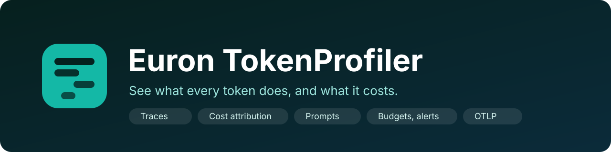
</p>

<p align="center">
  
  <a href="LICENSE"></a>
  
  
  
  
  
  
  
  
</p>

<p align="center">
  <a href="https://github.com/euron-sde-team/euron-token-profiler/stargazers"></a>
  <a href="https://github.com/euron-sde-team/euron-token-profiler/fork"></a>
  <a href="https://github.com/euron-sde-team/euron-token-profiler/watchers"></a>
  <br>
  <a href="https://github.com/euron-sde-team/euron-token-profiler/issues"></a>
  <a href="https://github.com/euron-sde-team/euron-token-profiler/pulls"></a>
  <a href="https://github.com/euron-sde-team/euron-token-profiler/commits/main"></a>
  
  <br>
  <a href="#built-by-the-team-behind-euron"></a>
</p>

<p align="center">
  <b><a href="#-quickstart">Quickstart</a></b> |
  <b><a href="#%EF%B8%8F-architecture">Architecture</a></b> |
  <b><a href="#-explore-the-repository">Explore the repo</a></b> |
  <b><a href="docs/api/openapi.json">API reference</a></b> |
  <b><a href="#%EF%B8%8F-deploy-to-aws">Deploy</a></b> |
  <b><a href="docs/architecture/security.md">Security</a></b> |
  <b><a href="#-documentation">Docs</a></b>
</p>

**Euron TokenProfiler** is an open-source, MIT-licensed LLM observability platform, part of the open-source
initiative of **ENGAGESPHERE TECHNOLOGY PRIVATE LIMITED**. A Python SDK and any OpenTelemetry exporter send
traces, spans and model calls to it; it stores them in PostgreSQL, works out what every token cost, and shows
where the tokens, dollars, latency and failures come from: per prompt version, model, agent and tool.

It is the self-hosted answer to Langfuse and LangSmith for teams whose prompts and completions cannot leave
their own infrastructure: a trace you can open and read, cost that adds up, prompts with a history,
budgets that warn before the invoice does, and PII masked before it is ever written.

- **Cost you can explain.** Each model call carries its tokens and a price from a maintained table with
  per-project overrides; agents and tools inherit the cost of the calls made inside them, so every
  breakdown adds up to the same total.
- **Two ways in.** The Python SDK (`@observe`, nested spans, prompt fetching, a background sender that never
  blocks your app) and OTLP/HTTP in JSON or protobuf, following the GenAI semantic conventions.
- **Safe by default.** Built-in and custom masking rules, optional no-payload mode, sampling that keeps
  errors and slow requests, retention with an encrypted archive.
- **Operable.** Budgets and alert rules with webhooks, dashboard aggregates cached in Valkey, health probes,
  Prometheus metrics, graceful shutdown.

The whole stack runs on a laptop with no cloud account and no API key (S3, KMS and Secrets Manager are
emulated and provisioned by the same Terraform that builds production), and deploys to AWS with one command.

<p align="center">
  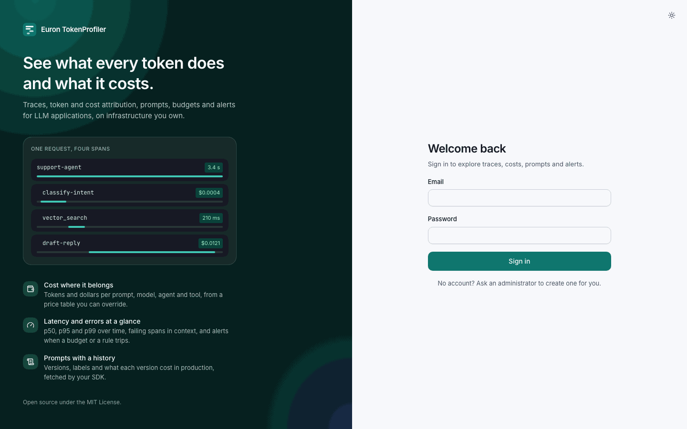
</p>

> [!NOTE]
> Everything in the tour ran for real: Docker Compose on a laptop, S3 and KMS emulated locally and provisioned
> by the same Terraform modules that build production, a worker evaluating budgets, and two weeks of traces
> on the seeded demo. The traffic is synthetic (a deterministic workload of five agents, six tools and ten
> models, with an incident, a runaway cost day and slow outliers) but it flows through the real ingest
> pipeline, so prices, attribution, masking and totals are computed by the product. `make up && make demo`
> reproduces it.

<h3 align="center">Built by the team behind Euron</h3>

<p align="center">Euron TokenProfiler comes from the people who build these platforms. If you like how this repository is built, come and see what we build with it.</p>

<p align="center">
  <a href="https://euron.one"><picture><source media="(prefers-color-scheme: dark)" srcset="docs/assets/brand/euron-dark.svg"></picture></a>
  <a href="https://euronsystems.com"><picture><source media="(prefers-color-scheme: dark)" srcset="docs/assets/brand/euron-systems-dark.svg"></picture></a>
  <a href="https://alphaeuron.com"><picture><source media="(prefers-color-scheme: dark)" srcset="docs/assets/brand/alpha-euron-dark.svg"></picture></a>
</p>

<p align="center">
  <a href="https://www.instagram.com/euron_official"></a>
  <a href="https://www.linkedin.com/company/euronone/posts/"></a>
  <a href="https://x.com/euron712"></a>
  <a href="https://www.youtube.com/@Euron-official"></a>
  <a href="https://whatsapp.com/channel/0029VaeeJwq9RZAfPW9P2l07"></a>
</p>

---

## 📚 Table of contents

- [Why Euron TokenProfiler](#-why-euron-tokenprofiler)
- [At a glance](#-at-a-glance)
- [Screenshots](#%EF%B8%8F-screenshots)
- [Features](#-features)
- [Architecture](#%EF%B8%8F-architecture)
  - [Life of a trace](#life-of-a-trace)
  - [How cost is attributed](#how-cost-is-attributed)
- [Tech stack](#-tech-stack)
- [Prerequisites](#-prerequisites)
- [Quickstart](#-quickstart)
- [Explore the repository](#-explore-the-repository)
- [API](#-api)
- [Configuration](#%EF%B8%8F-configuration)
- [Deploy to AWS](#%EF%B8%8F-deploy-to-aws)
- [Security model](#-security-model)
- [Testing](#-testing)
- [Documentation](#-documentation)
- [Roadmap](#%EF%B8%8F-roadmap)
- [FAQ](#-faq)
- [Contributing, security and license](#-contributing-security-and-license)

---

## 💡 Why Euron TokenProfiler

LLM applications fail quietly and cost loudly. A prompt tweak doubles the token bill; an agent loops on a
tool; a provider times out for two hours on a Tuesday; a support transcript with a card number lands in a
log. Logs and APM do not understand tokens, prompts or agents, and hosted LLM observability means sending your
customers' conversations to someone else.

TokenProfiler keeps the data where you run it, and answers the questions that come up every week:

- Which agent, tool, model or prompt version is spending the money, and is it getting better or worse?
- Why was this request slow or wrong? What did each step receive and return?
- Did the new prompt version cost less per call, and did its error rate move?
- Are we about to blow the monthly budget? Who is told, and when?
- What exactly is stored about our users, for how long, and who can read it?

## 📊 At a glance

| Item        | Detail                                                                                                                     |
| ----------- | -------------------------------------------------------------------------------------------------------------------------- |
| Ingest      | Python SDK, OTLP/HTTP JSON and protobuf (gzip), plain HTTP; GenAI, OpenInference, Traceloop attributes                     |
| Attribution | Tokens and USD per prompt version, model, agent and tool; cached-token discounts; estimated usage flagged                  |
| Prices      | 46 builtin models, per-project overrides, decimal arithmetic, cost fixed at ingest and explainable                         |
| Privacy     | 7 built-in detectors plus custom patterns, no-payload mode, sampling, retention, encrypted archive                         |
| Alerts      | Budgets per day, week or month (project, model, agent, tool or prompt); rules on errors, latency, spend, silence; webhooks |
| Performance | Denormalised trace totals, partial indexes, bounded counts, cached aggregates, one statement per 400 spans                 |
| Runs on     | Docker Compose with PostgreSQL 16, Valkey 8 and the Floci AWS emulator; ECS Fargate, RDS, ElastiCache on AWS               |
| Tests       | 55 API unit, 44 API integration, 13 SDK, 39 web unit, 21 browser journeys, crawl of every page                             |

## 🖼️ Screenshots

<table>
  <tr>
    <td width="50%">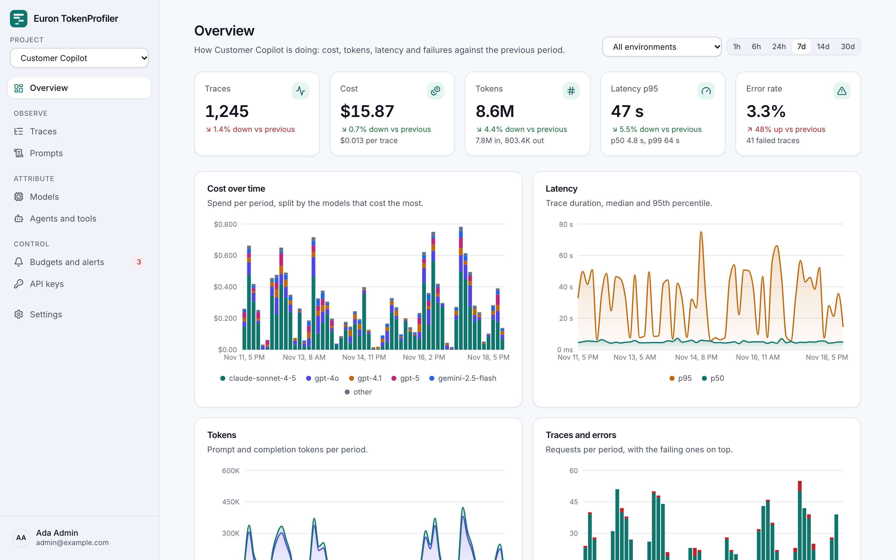<br><sub><b>Overview.</b> Cost, tokens, latency and failures against the previous period.</sub></td>
    <td width="50%">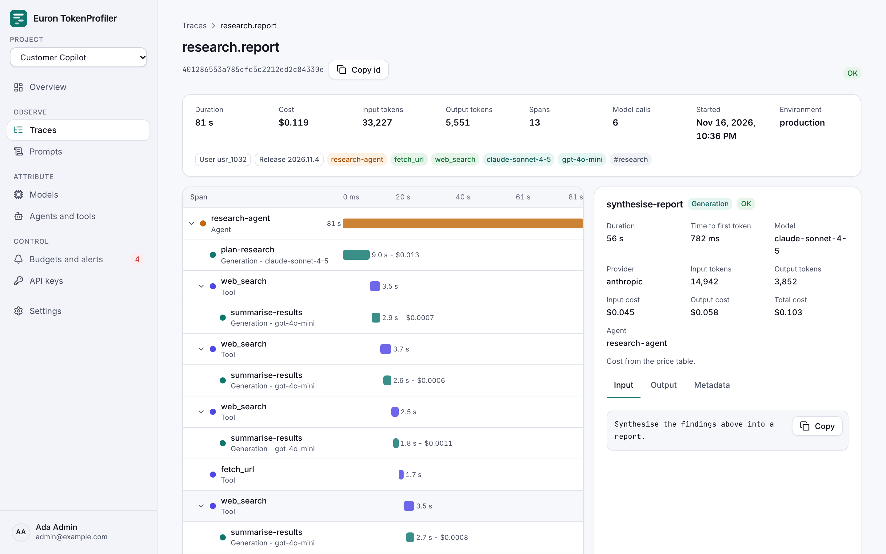<br><sub><b>Trace waterfall.</b> The span tree on a timeline; each model call with its tokens, cost and payloads.</sub></td>
  </tr>
  <tr>
    <td>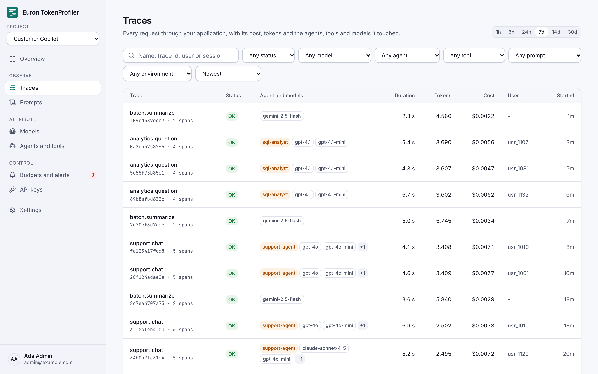<br><sub><b>Traces.</b> Filter by status, model, agent, tool, prompt, user or text.</sub></td>
    <td>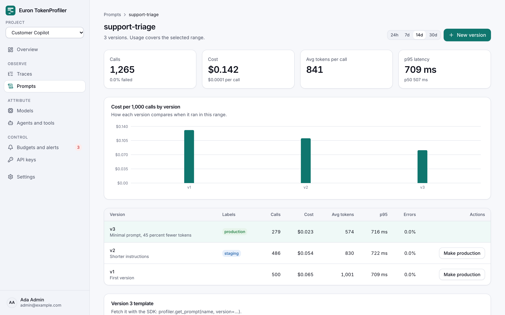<br><sub><b>Prompts.</b> Versions and labels, and what each version cost in production.</sub></td>
  </tr>
  <tr>
    <td>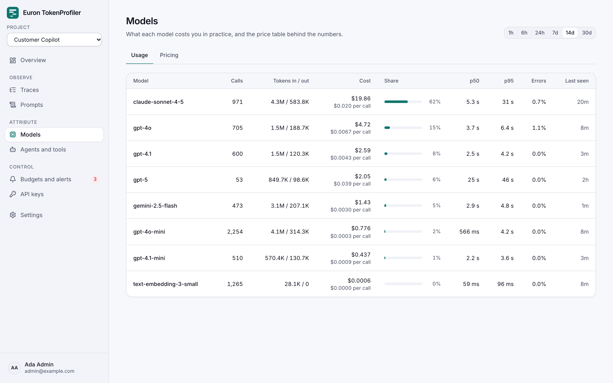<br><sub><b>Models.</b> Where the money goes, with latency and error rates.</sub></td>
    <td>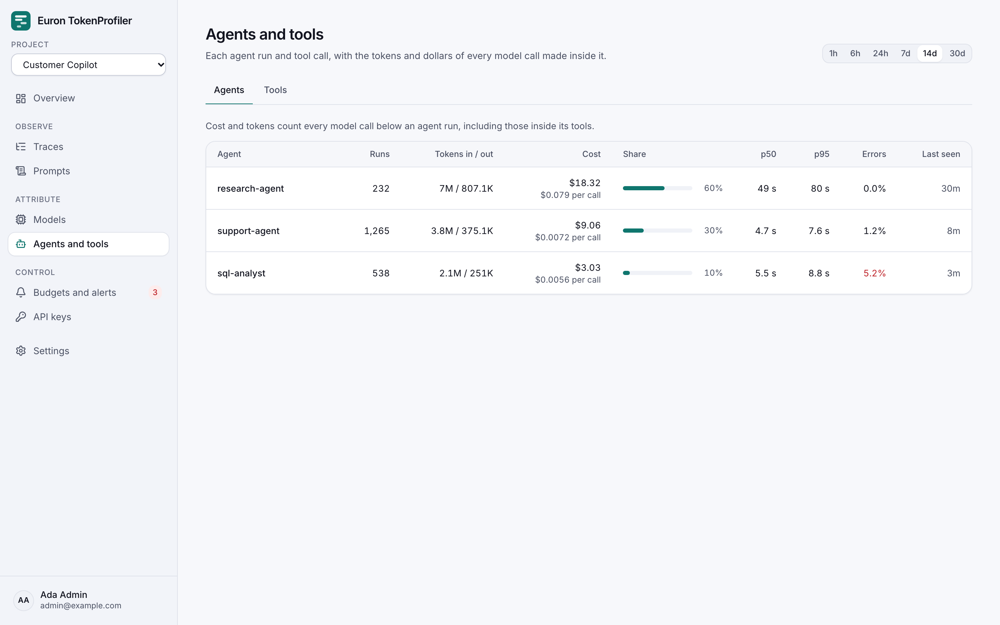<br><sub><b>Agents and tools.</b> Cost includes every model call inside the agent or tool.</sub></td>
  </tr>
  <tr>
    <td>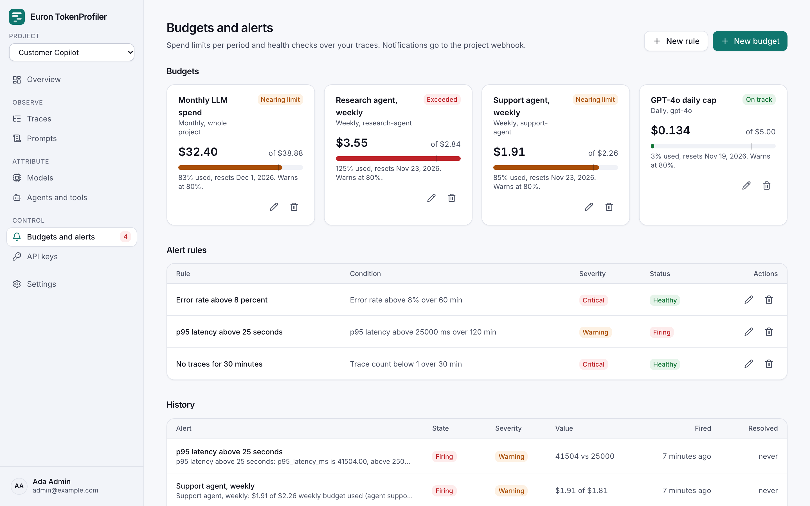<br><sub><b>Budgets and alerts.</b> Limits per period and health rules, with history.</sub></td>
    <td>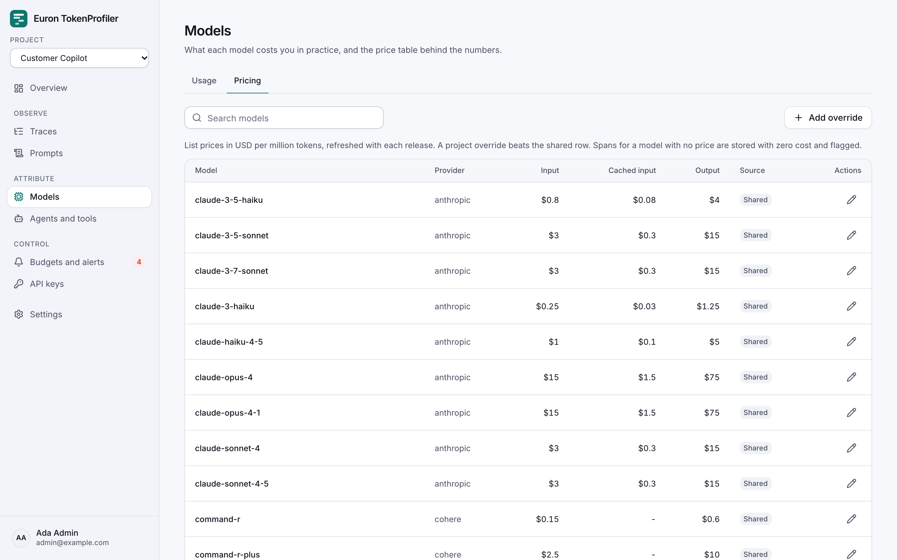<br><sub><b>Pricing.</b> The table behind every number, with overrides for negotiated or self-hosted rates.</sub></td>
  </tr>
  <tr>
    <td>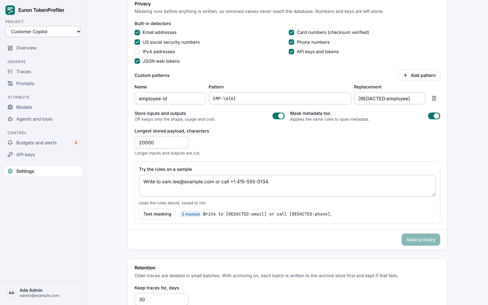<br><sub><b>Privacy.</b> Masking rules with a live tester, sampling, retention and the webhook.</sub></td>
    <td>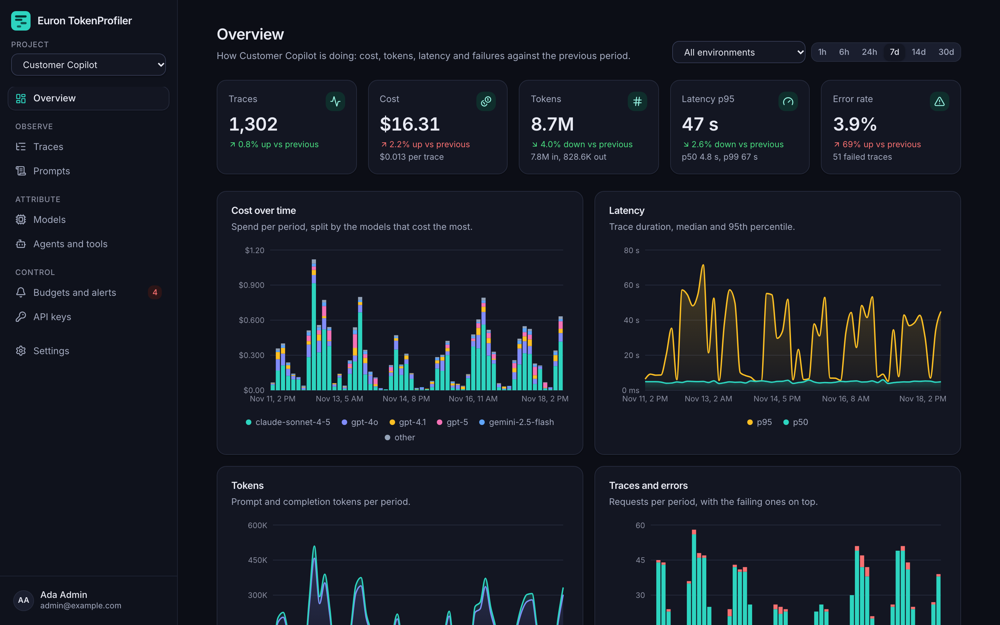<br><sub><b>Dark theme.</b> Follows the system setting, switchable from the account menu.</sub></td>
  </tr>
</table>

## ✨ Features

| Area            | What you get                                                                                                                                                                                                       |
| --------------- | ------------------------------------------------------------------------------------------------------------------------------------------------------------------------------------------------------------------ |
| Ingest          | Native batch endpoint with per-item validation; OTLP/HTTP in JSON and protobuf with gzip; per-key rate limits with `Retry-After`; bounded decompression                                                            |
| SDK             | `@observe` for sync and async functions, nested spans through `contextvars`, errors recorded and re-raised, prompt fetching with a cache, `usage_from` for common clients, a sender that drops instead of blocking |
| Traces          | Filters (status, model, agent, tool, prompt, environment, user, session, tag, cost, duration), full-text name search, sorting, capped counts, a waterfall with collapsible subtrees and a span panel               |
| Cost            | Price table with regex matching and project overrides, cached-input discounts, estimated usage flagged, reported costs honoured, unpriced models marked                                                            |
| Attribution     | Agent and tool names inherited down the tree; breakdowns per model, agent, tool and prompt version that add up to the total                                                                                        |
| Dashboards      | KPIs against the previous period, latency percentiles, tokens, cost stacked by model, errors, top lists; aggregates cached in Valkey                                                                               |
| Prompts         | Immutable versions, movable labels (production, staging), fetch by label or version, usage and cost per version, versions auto-registered from traces                                                              |
| Privacy         | Seven detectors (email, card with Luhn, SSN, phone, IPv4, API keys, JWT), custom patterns validated for safety, no-payload mode, payload length limit, live tester                                                 |
| Sampling        | Per trace id, so kept traces are complete; failing traces and slow spans always kept                                                                                                                               |
| Budgets, alerts | Budgets per period and scope, rules on error rate, p95, spend and silence, one open event per source, escalation, webhook delivery with an SSRF guard                                                              |
| Retention       | Per project days, batch deletes, optional gzip NDJSON archive to S3 (SSE-KMS) or a volume, kept if archiving fails                                                                                                 |
| People          | Admin, member and viewer roles; Argon2id; instant session revocation; audit trail                                                                                                                                  |
| Operations      | `/livez`, `/readyz`, Prometheus metrics, JSON logs with request ids, graceful shutdown, advisory-locked migrations                                                                                                 |

## 🏗️ Architecture

<p align="center">
  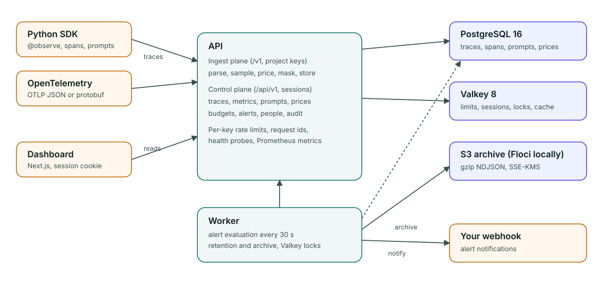
</p>

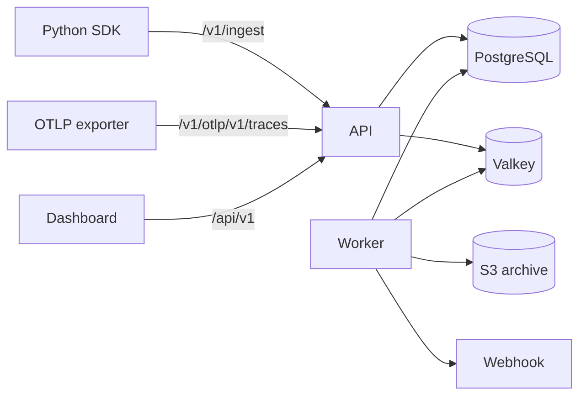

### Life of a trace

1. The SDK or exporter posts a batch with a project key; the API resolves the key and applies the per-key
   rate limit.
2. The body (native, OTLP JSON or protobuf, gzip or not) becomes one normalised shape.
3. Sampling keeps or drops each trace by its id; errors and slow spans override.
4. Each span gets its usage (estimated when missing) and its cost (reported, from the price table, or unknown),
   then its payloads are masked and cut to the project's limit.
5. One transaction upserts traces and spans, inherits agent and tool names down each tree, recomputes the
   trace totals and registers prompt versions first seen in traces.
6. The dashboard reads the denormalised totals; breakdowns aggregate spans through partial indexes and are
   cached for 30 seconds.

### How cost is attributed

Only generations and embeddings carry tokens and cost. Every span also carries the nearest agent and tool above
it, so the cost of a `web_search` tool is the cost of the summariser call inside it, the cost of an agent is
everything it triggered, and each of those, per model and per prompt version, adds up to the same total
([ADR 0002](docs/architecture/adr/0002-attribution-by-inheritance.md)).

## 🧰 Tech stack

| Layer   | Choice                                                                                                                             |
| ------- | ---------------------------------------------------------------------------------------------------------------------------------- |
| API     | Python 3.12, FastAPI, Pydantic v2, SQLAlchemy 2 (async, asyncpg), Alembic, redis-py, httpx, structlog, orjson, opentelemetry-proto |
| SDK     | Python 3.10+, httpx, `contextvars`                                                                                                 |
| Web     | Next.js 16 (App Router, standalone), React 19, TypeScript strict, Tailwind CSS 4, TanStack Query, Recharts, Radix                  |
| Data    | PostgreSQL 16 (partial and GIN indexes, `date_bin`, `percentile_cont`), Valkey 8                                                   |
| Quality | uv, ruff, mypy strict, pytest, ESLint 9, Prettier, Vitest, Playwright, axe                                                         |
| Infra   | Docker Compose, Floci (local AWS), Terraform 1.10+, ECS Fargate, RDS, ElastiCache, S3, KMS, tflint, checkov                        |

## 📋 Prerequisites

Docker with Compose v2 (Colima works), GNU make and about 8 GB of RAM. For development: Python 3.12 with
[uv](https://docs.astral.sh/uv/), Node 22 and pnpm 9.

## 🚀 Quickstart

```bash
make up      # builds and starts everything on emulated AWS (a few minutes the first time)
make demo    # people, two projects, prompts, budgets, alerts and two weeks of traces
```

Open <http://localhost:3210> and sign in as `admin@example.com` (the password is `TP_DEMO_PASSWORD` in
`deploy/compose/.env`). `make demo` prints the ingest key of the demo project. Send your own trace:

```bash
pip install ./sdk/python
python - <<'PY'
from tokenprofiler_sdk import TokenProfiler
profiler = TokenProfiler(base_url="http://localhost:8210", api_key="tp_...")
with profiler.generation("hello", model="gpt-4o", input="Hi") as call:
    call.update(output="Hello!", usage={"input": 812, "output": 96})
profiler.flush()
PY
```

OpenTelemetry: `OTEL_EXPORTER_OTLP_ENDPOINT=http://localhost:8210/v1/otlp` and
`OTEL_EXPORTER_OTLP_HEADERS="Authorization=Bearer tp_..."`. `make down` stops everything and removes its
volumes. More in [docs/guides/quickstart-local.md](docs/guides/quickstart-local.md) and
[docs/guides/instrumentation.md](docs/guides/instrumentation.md).

## 🧭 Explore the repository

```text
apps/api/        FastAPI service: ingest/ (pure parsing, masking, pricing, sampling, attribution),
                 services/, repositories/, api/, worker, CLI, demo seed, migrations, tests
apps/web/        Next.js dashboard: overview, traces, prompts, models, agents, budgets, keys, settings
sdk/python/      The Python SDK (tokenprofiler-sdk)
infra/terraform/ Modules and the local-floci, aws-dev and aws-prod environments
infra/docker/    API and web Dockerfiles
deploy/compose/  Compose base, Floci overlay (Terraform one-shot) and AWS overlay
e2e/             Playwright journeys, the QA crawl and the screenshot capture
docs/            Architecture, ADRs, guides, OpenAPI export, assets
scripts/         Local env, test dependencies, sanitization, AWS deploy
```

## 🔌 API

Two planes. The **ingest plane** (`/v1`) takes a project key: `POST /v1/ingest`, `POST /v1/otlp/v1/traces`,
`GET /v1/prompts/{name}`. The **control plane** (`/api/v1`) takes a session and serves projects, traces,
metrics, prompts, prices, budgets, alerts, people and the audit trail. Every error is
`{"error": {"code", "message", "request_id", "details?"}}`. Reference:
[docs/api/README.md](docs/api/README.md) and [openapi.json](docs/api/openapi.json); a running stack serves
Swagger at <http://localhost:8210/docs>.

## ⚙️ Configuration

Environment variables, validated at start; production refuses development defaults and lists every problem at
once. The essentials: `SESSION_SECRET`, `API_KEY_PEPPER`, `ENCRYPTION_KEY` (32+ characters, all different),
`DATABASE_URL`, `REDIS_URL`, `CORS_ORIGINS`, `COOKIE_SECURE`, and for the archive `ARCHIVE_STORE`, `S3_BUCKET`,
`S3_KMS_KEY_ID`. Per project (in the dashboard): sampling, masking, retention, webhook. Full table:
[docs/guides/configuration.md](docs/guides/configuration.md).

## ☁️ Deploy to AWS

```bash
cp infra/terraform/envs/aws-dev/terraform.tfvars.example infra/terraform/envs/aws-dev/terraform.tfvars
make aws-deploy ENV=aws-dev      # registries, ARM64 images, infrastructure, rollout
make aws-cli ENV=aws-dev ARGS="user create --email you@example.com --name You --role admin --password ..."
```

ECS Fargate services behind an ALB (HTTPS, optional WAF), RDS PostgreSQL 16, ElastiCache Valkey, an S3 bucket
for the trace archive, one KMS key, Secrets Manager, CloudWatch alarms and a dashboard. One host name serves the
dashboard, the API and ingest. See [docs/guides/deploy-aws.md](docs/guides/deploy-aws.md).

## 🔒 Security model

Project keys are shown once and stored as keyed hashes; sessions carry a version that signs people out
everywhere when a password or role changes; passwords use Argon2id; cookies are `httpOnly` and origin-checked.
PII is masked before storage, webhook URLs are sealed with AES-256-GCM and checked against private addresses
on save and on delivery, custom patterns are validated against catastrophic backtracking, request and
decompressed bodies are bounded, and the process refuses to start in production with unsafe settings. Read
[docs/architecture/security.md](docs/architecture/security.md) and the
[STRIDE threat model](docs/architecture/threat-model.md), and report vulnerabilities as described in
[SECURITY.md](SECURITY.md).

## 🧪 Testing

| Suite                                                                                 | Count    | Command                 |
| ------------------------------------------------------------------------------------- | -------- | ----------------------- |
| API unit (pytest)                                                                     | 55       | `make test`             |
| SDK unit (pytest)                                                                     | 13       | `make test`             |
| Web unit (Vitest)                                                                     | 39       | `make test`             |
| API integration (real PostgreSQL, Valkey, Floci; real application over ASGI)          | 44       | `make test-integration` |
| Browser end-to-end (Playwright, Chromium)                                             | 21       | `make e2e`              |
| QA crawl (every page at desktop and mobile, plus dark; console, requests, links, axe) | 5 crawls | `make qa`               |

Static checks: ruff, mypy in strict mode, ESLint, Prettier and `tsc` are clean; `make sanitize` and
`make tf-fmt tf-validate` are clean for all three environments, tflint is clean and checkov reports no failed
checks. Details in [docs/guides/testing.md](docs/guides/testing.md).

## 📖 Documentation

| Topic                                  | Page                                                                                                                                                                                                                                                                                                                                                                  |
| -------------------------------------- | --------------------------------------------------------------------------------------------------------------------------------------------------------------------------------------------------------------------------------------------------------------------------------------------------------------------------------------------------------------------- |
| Product, containers, flows, deployment | [HLD](docs/architecture/HLD.md)                                                                                                                                                                                                                                                                                                                                       |
| Modules, algorithms, protocols         | [LLD](docs/architecture/LLD.md)                                                                                                                                                                                                                                                                                                                                       |
| Tables and indexes                     | [Data model](docs/architecture/data-model.md)                                                                                                                                                                                                                                                                                                                         |
| Controls                               | [Security](docs/architecture/security.md)                                                                                                                                                                                                                                                                                                                             |
| Threats                                | [Threat model (STRIDE)](docs/architecture/threat-model.md)                                                                                                                                                                                                                                                                                                            |
| Decisions                              | [ADRs](docs/architecture/adr/README.md)                                                                                                                                                                                                                                                                                                                               |
| Guides                                 | [Quickstart](docs/guides/quickstart-local.md), [Instrumentation](docs/guides/instrumentation.md), [Configuration](docs/guides/configuration.md), [Deploy to AWS](docs/guides/deploy-aws.md), [Operations](docs/guides/operations.md), [Testing](docs/guides/testing.md), [Troubleshooting](docs/guides/troubleshooting.md), [Walkthrough](docs/guides/walkthrough.md) |
| API                                    | [Guide](docs/api/README.md), [OpenAPI](docs/api/openapi.json)                                                                                                                                                                                                                                                                                                         |

## 🗺️ Roadmap

- Evaluations and datasets: score traces, compare prompt versions offline
- Sessions view and user-level cost
- Tail sampling and a collector-side processor
- Repricing past spans as an audited action
- OIDC sign-in, per-project access and per-team quotas
- Node and TypeScript SDKs

## ❓ FAQ

**Does it need an API key or a cloud account?** No. Docker Compose runs everything, including S3 and KMS on an
emulator. TokenProfiler never calls an LLM itself; it records what your application did.

**Is the demo data real?** It is a deterministic synthetic workload sent through the real ingest pipeline: the
traces, prices, attribution, masking and totals are computed by the product, the prompts and answers are
canned. The seed refuses to run in production.

**Where do prices come from?** `apps/api/src/tokenprofiler/pricing/prices.json` holds list prices per million
tokens, refreshed with each release. Verify them against your invoice and add a project override for what you
pay. A model with no price is stored at zero cost and marked.

**Can I use my OpenTelemetry setup?** Yes. Point an OTLP/HTTP exporter (JSON or protobuf) at `/v1/otlp` with
your key. GenAI semantic convention attributes are understood, as are OpenInference and Traceloop kinds.

**What does masking guarantee?** That values matching your rules never reach the database, cache or archive.
It is pattern based, so it can miss unusual formats; do not rely on it as the only control for secrets.

**What if the database or Valkey is down?** `readyz` reports it and ingest returns errors; the SDK retries with
backoff and drops events (counted in `profiler.stats`) rather than blocking your application.

**Do projects isolate people?** Projects isolate data and keys. Every signed-in person sees every project; run
a deployment per tenant when that is not acceptable.

## 🤝 Contributing, security and license

Contributions are welcome: read [CONTRIBUTING.md](CONTRIBUTING.md) and the
[Code of Conduct](CODE_OF_CONDUCT.md). Report vulnerabilities privately as described in
[SECURITY.md](SECURITY.md). Released under the [MIT License](LICENSE). Copyright (c) 2026
ENGAGESPHERE TECHNOLOGY PRIVATE LIMITED and the TokenProfiler contributors.
