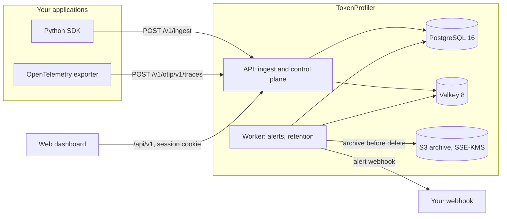

# High-level design

Euron TokenProfiler is open-source LLM observability: it records what an LLM application does
(traces, spans, model calls, tool calls, agent runs), attributes tokens and dollars to the prompt,
model, agent and tool responsible, and tells you when cost, latency or errors leave their bounds.
It is the self-hosted answer to Langfuse and LangSmith, published by ENGAGESPHERE TECHNOLOGY
PRIVATE LIMITED.

## Goals and non-goals

Goals:

- Accept traces from a Python SDK and from any OpenTelemetry exporter (OTLP/HTTP, JSON or
  protobuf), with no collector required.
- Make cost explainable: every dollar belongs to one model call, which belongs to one agent run
  and at most one tool call and one prompt version, from a maintained price table with per-project
  overrides.
- Be safe by default: PII is masked and payloads are cut to a limit before anything is written;
  sampling and retention keep volume and risk bounded.
- Run entirely locally with no cloud account and no paid key (Postgres, Valkey, the Floci AWS
  emulator), and deploy to AWS from the same Terraform modules.

Non-goals (first release): evaluation and dataset management, a prompt playground that calls
models, per-user billing, multi-organisation tenancy. Projects are the isolation unit; people see
every project.

## Users and what they do

| Person       | Needs                                                                   | Where                             |
| ------------ | ----------------------------------------------------------------------- | --------------------------------- |
| Developer    | Send traces, see why a request was slow, expensive or wrong             | SDK, traces, trace detail         |
| Prompt owner | Ship prompt versions, see what each cost and how it performs            | Prompts                           |
| Team lead    | Know where spend goes, set limits, be told before a bill surprises them | Overview, models, agents, budgets |
| Security     | Keep PII and secrets out of storage, bound retention                    | Settings: privacy, retention      |
| Operator     | Deploy, scale, back up, keep the system observable itself               | Compose, Terraform, metrics       |

## System context

Components:

- **API** (FastAPI, one image): the ingest plane (`/v1`, project keys) and the control plane
  (`/api/v1`, signed-in people). Stateless; scale by adding replicas.
- **Worker** (same image): evaluates budgets and alert rules every 30 seconds and enforces
  retention, each loop elected through a Valkey lock so extra workers are standbys.
- **Web** (Next.js, standalone): the dashboard; reads runtime configuration from `/env.js`, so one
  image serves every environment.
- **PostgreSQL**: all durable state. Traces and spans have composite keys led by the project and
  indexes for the hot queries.
- **Valkey**: rate-limit windows, revoked sessions, worker locks, the dashboard aggregate cache.
- **S3** (Floci locally): the trace archive written before retention deletes.

## Data flow: ingest

1. The SDK or exporter sends a batch with `Authorization: Bearer tp_...`.
2. The API resolves the key (prefix lookup, HMAC compare), checks the per-key rate limit and
   converts the body (native, OTLP JSON or OTLP protobuf, optionally gzip) into one normalised
   shape.
3. Per trace: sampling decides keep or drop (errors and slow spans override).
4. Per span: usage is estimated when missing, cost is computed (reported, or price table, or
   unknown), then payloads and metadata are masked and truncated.
5. In one transaction: advisory lock per trace, upsert traces and spans, inherit agent and tool
   names down each span tree, recompute the trace totals with one SQL statement, register prompt
   versions first seen in traces, commit.

## Data flow: reading

The dashboard calls the control plane with the session cookie. Lists and details read the
denormalised `traces` table; breakdowns aggregate `spans` through partial indexes; overview and
breakdown results are cached in Valkey for 30 seconds under a key that always contains the
project id.

## Cost attribution model

A **metered span** is a generation or an embedding: only these carry tokens and cost, so parents
never double count. Every span also carries the nearest agent and tool names above it. Therefore:

- cost per **model** = sum over metered spans grouped by model;
- cost per **agent** = metered spans whose nearest agent is that agent (including those inside its
  tools);
- cost per **tool** = metered spans whose nearest tool is that tool (a summariser or an embedding
  call made inside it); the tool's own latency and error rate come from its tool spans;
- cost per **prompt version** = metered spans tagged with that prompt name and version.

Each metered span has exactly one agent, at most one tool and at most one prompt, so each of
these breakdowns adds up to the project total (the per-trace tests assert it).

## Cross-cutting concerns

- **Security**: Argon2id passwords, HS256 session JWTs with a server-side version for instant
  revocation, HMAC-hashed project keys, AES-GCM sealed webhook URLs, CSRF origin checks, SSRF
  guard on webhooks. See [security.md](security.md) and [threat-model.md](threat-model.md).
- **Observability of the observer**: structured JSON logs with a request id, Prometheus metrics
  for ingest volume, latency, redactions, cache hits, alerts and retention; `/livez`, `/readyz`,
  `/metrics` (kept off the public load balancer).
- **Failure behaviour**: the SDK never blocks or raises into the host application; the API returns
  429 with `Retry-After` before it falls over; retention keeps data if the archive write fails.
- **Scalability**: write path is batch oriented (one statement per 400 spans, one aggregate
  update per batch); reads are index driven and capped (list totals stop counting at 10,000).

## Deployment views

- **Local**: `make up` runs Postgres, Valkey, Floci, a Terraform one-shot that provisions the
  emulator with the production modules, the API, the worker and the web app on loopback ports
  3210, 8210, 5461, 6421 and 4621.
- **AWS**: ECS Fargate services (api, worker, web) behind an ALB with HTTPS, RDS PostgreSQL 16,
  ElastiCache for Valkey, an S3 archive bucket, one KMS key, Secrets Manager, CloudWatch. `aws-dev`
  and `aws-prod` call one deployment module with different sizes and safety switches.

## Quality attributes

| Attribute       | Approach                                                                          |
| --------------- | --------------------------------------------------------------------------------- |
| Correctness     | Costs from a decimal price table; totals recomputed from spans; asserted in tests |
| Privacy         | Masking before storage; payloads optional; archives encrypted                     |
| Performance     | Denormalised totals, partial indexes, bounded counts, cached aggregates           |
| Operability     | Health probes, metrics, graceful shutdown, advisory-locked migrations             |
| Portability     | Everything on Compose and Floci; the same Terraform for AWS                       |
| Maintainability | One job per layer, strict types, pure ingest logic with unit tests                |
