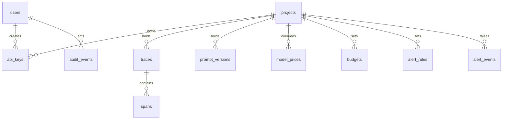

# Data model

PostgreSQL 16. Identifiers are UUIDv7 (time ordered) except traces and spans, whose ids come from
the client. Timestamps are `timestamptz` in UTC. Money is `numeric`, never float. Check
constraints keep enumerations honest; the migration (`0001_initial_schema.py`) names every index.

## Tables

| Table             | Purpose                                                              | Key                              |
| ----------------- | -------------------------------------------------------------------- | -------------------------------- |
| `users`           | People: email (citext), Argon2 hash, role, session version, lockout  | `id`; unique `email`             |
| `projects`        | Isolation unit and its rules: sampling, redaction JSON, retention, sealed webhook | `id`; unique `slug` |
| `api_keys`        | Project ingest keys: prefix, HMAC of the secret, last use, revocation | `id`; unique `prefix`           |
| `traces`          | One request, with totals denormalised from its spans                 | `(project_id, id)`               |
| `spans`           | One step: kind, timing, attribution, model, usage, cost, payloads    | `(project_id, trace_id, id)`     |
| `prompt_versions` | Immutable prompt versions with labels; `managed` false when first seen in traces | unique `(project_id, name, version)` |
| `model_prices`    | USD per million tokens; `project_id` null is the shared table        | partial unique per scope         |
| `budgets`         | Spend limit per period, project wide or per model, agent, tool, prompt | `id`                           |
| `alert_rules`     | Metric, comparator, threshold, window, minimum traces, severity      | `id`                             |
| `alert_events`    | One firing from open to resolved; notification outcome               | `id`; unique open per source     |
| `audit_events`    | Who changed what, optionally per project                             | `id`                             |

## traces

| Column                                         | Notes                                                        |
| ---------------------------------------------- | ------------------------------------------------------------ |
| `name`, `user_id`, `session_id`, `environment`, `release`, `tags[]` | Trace-level context; environment defaults to `default` |
| `started_at`, `ended_at`, `duration_ms`        | Min start and max end over the spans                         |
| `status`                                       | `error` when any span failed                                 |
| `input`, `output`, `metadata`                  | Masked at ingest; the root span's payloads unless declared   |
| `span_count`, `error_count`, `generation_count`| Recomputed per batch                                         |
| `input_tokens`, `output_tokens`, `total_tokens`, `total_cost` | Sums over metered spans only                  |
| `models[]`, `agents[]`, `tools[]`, `prompts[]` | Distinct names, GIN indexed, drive the list filters          |

Indexes (all lead with `project_id` unless a GIN):

- `(project_id, started_at desc)`: the default list and the dashboards;
- partial `(project_id, started_at desc) where status = 'error'`: the failures view;
- `(project_id, total_cost desc)`, `(project_id, duration_ms desc)`: sorting;
- partial `(project_id, user_id, started_at desc)` and `(project_id, session_id, started_at desc)`;
- GIN on `tags`, `models`, `agents`, `tools`, `prompts`; GIN trigram on `name` for the search.

## spans

| Column group      | Columns                                                                              |
| ----------------- | ------------------------------------------------------------------------------------ |
| Identity          | `project_id`, `trace_id`, `id`, `parent_id`; FK to `traces` with `ON DELETE CASCADE` |
| Shape             | `name`, `kind` (span, generation, embedding, agent, tool, retriever), `level`        |
| Timing and status | `started_at`, `ended_at`, `duration_ms`, `time_to_first_token_ms`, `status`, `status_message` |
| Attribution       | `agent_name`, `tool_name` (inherited down the tree), `prompt_name`, `prompt_version` |
| Model call        | `model`, `provider`, `model_parameters`                                              |
| Usage and cost    | `input_tokens`, `output_tokens`, `cached_tokens`, `total_tokens`, `usage_estimated`, `input_cost`, `output_cost`, `total_cost`, `cost_source` (reported, table, none) |
| Payloads          | `input`, `output`, `metadata`, `redactions` (count of masked values)                 |

Indexes: `(project_id, started_at)`, `(project_id, kind, started_at)`, and partial
`(project_id, <key>, started_at)` for `model`, `agent_name`, `tool_name` and
`(project_id, prompt_name, prompt_version, started_at)`, each `where <key> is not null`. They serve
the breakdowns, the budget spend queries and the per-prompt usage.

## Money

`numeric(18,8)` for span and trace cost; `numeric(14,6)` for prices per million tokens;
`numeric(14,4)` for budget limits. The API sends decimals as strings so the browser never rounds
them.

## Retention

`retention_days` is per project. Deleting a trace cascades to its spans; archived objects live in
the archive store, not the database. Resolved alert events are purged after 90 days.

## Migrations

Alembic, shipped inside the package. `MIGRATE_ON_BOOT=true` applies them from the API and the
worker under `pg_advisory_xact_lock`, so any number of replicas can start together and the
migration runs once. Never edit an applied revision; add a new one.
